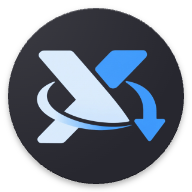

<p align="center">
  
</p>

<h1 align="center">Xmd — Xtreme Media Downloader</h1>

<p align="center">
  <b>An Android download manager for FuckingFast share links, with a built-in torrent client, yt-dlp-powered YouTube downloads, and a fast in-app browser.</b>
  <br>
  <i>An Android port of the original PyQt5 desktop downloader — no bloat, just downloads that resume.</i>
</p>

> [!IMPORTANT]
> **`v1.1.0`** — GitHub sync, a new uBlock/ABP-compatible ad blocker, a Sort & view dialog for Downloads, faster Private DNS and more. See [CHANGELOG.md](CHANGELOG.md) for what's new.

<p align="center">
  
  
  
  
</p>

<p align="center">
  <a href="https://github.com/Utsavrajputt/xmd/actions/workflows/android-build.yml">
    
  </a>
  <a href="https://github.com/Utsavrajputt/xmd/deployments/github-pages">
    
  </a>
  <a href="https://github.com/Utsavrajputt/xmd/actions/workflows/release.yml">
    
  </a>
</p>

<p align="center">
  
  
  
  
</p>

<p align="center">
  <sub>⭐ • 🍴 • 🕓 • 🐛 &nbsp;—&nbsp; if Xmd's useful to you, a star helps more than you'd think</sub>
</p>

---

## 📸 Screenshots

<p align="center">
  
</p>

<sub>Auto-generated from <a href="fastlane/metadata/android/en-US/images/phoneScreenshots">fastlane/metadata/android/en-US/images/phoneScreenshots</a> by <a href="scripts/generate-screenshot-carousel.sh">scripts/generate-screenshot-carousel.sh</a> — drop screenshots in that folder and it rebuilds itself on push.</sub>

---

## ✨ Features

<details>
<summary><b>📥 Downloader</b></summary>

| Feature | Description |
|---|---|
| **Multi-source links** | Paste `fuckingfast.co` share links, `dl.fuckingfast.co` direct links, or a `fitgirl-repacks.site` page URL — source pages are expanded into their share links automatically |
| **Cloudflare/Turnstile handling** | In-app WebView challenge screen opens the share page so you can clear verification yourself; the direct URL is captured automatically once cleared |
| **Resumable downloads** | Pause/cancel-able downloads running in a foreground service, surviving app backgrounding and killed-process long pauses |
| **Auto-categorized downloads** | IDM-style sorting by extension into `Videos`, `Music`, `Documents`, `Apps`, or `Others` (or flat into Downloads via a Settings toggle) |
| **Retry system** | Auto-retry on network errors (off by default, toggle in Settings), an expired-link retry popup, and per-item/bulk retry & clear actions |
| **Persistent queue** | Room-backed download queue that survives app restarts, with auto-resume of queued items and manual Start/Clear controls |
| **Open & stats** | Open finished downloads directly from the list; download stats shown for YouTube items; tap the done/failed stats pill on Home to jump straight to that Downloads tab |
| **Share target** | A transparent `ShareReceiverActivity` handles links shared from other apps (e.g. Morphe) without ever bringing Xmd's main UI to the foreground — YouTube links get a quick bottom-sheet quality picker, everything else queues and starts silently |
| **Download on Wi-Fi Only** | Optional setting (off by default) that auto-pauses all live downloads when Wi-Fi drops and resumes them when it's back |
| **Default YouTube quality** | Pick "Ask always" or lock in a fixed quality to skip the picker sheet on every YouTube download |
| **Video preset & audio format** | Preferred container/codec/FPS ladder for quick quality picks, plus a default audio format (MP3, M4A, Opus, or Original) for Audio-only downloads |
| **Advanced quality section** | A real yt-dlp format probe surfaced as a collapsible list showing exact FPS/codec/file size per stream, alongside the standard ladder |
| **Daily data limit** | Optional total or mobile-only data cap for downloads, set from Settings |
| **Link validation** | Links are checked in the Add Download dialog before a download starts, catching bad/unsupported links earlier |
| **Home screen shortcuts** | Pin a download link to the device home screen for one-tap re-download, with an "Add to home screen" flow and a toggle to remove it later |
| **Expired-link recovery** | A redesigned Link Expired dialog offers Retry, Fetch from Browser, **Resume with a new link**, or Cancel — retry tries a normal re-fetch first, falling back to the browser and finally a single-connection download only if needed. Tapping outside or going back only closes the dialog; the item is cleared only with Clear |
| **Resume with a new link** | A failed *expired* download can continue from its partial file with a fresh link (also offered as "Resume existing" when adding a duplicate) |
| **Real filenames, fast** | The Add Download dialog resolves the real file name with overlapping, cached lookups, and items are renamed automatically once the true name is known |
| **Duplicate detection** | Path-based detection catches a file already in the queue, with a resolution strategy (numbered copy, override, or resume) instead of silently re-downloading it |
| **Multi-selection** | Select multiple queue items at once for contextual bulk actions |
| **Sort & view** | One compact dialog from the Downloads sort button: sort by Date / Name / Size / Type (tap again to reverse), group by Date or Type, Comfortable or Compact rows, pick which filter tabs to show, and toggle item details (file icon, type badge, size, time taken, date, actions, full file name). Applied live, remembered, with Reset |
| **Background downloads for shares** | Links shared from other apps or opened externally show a floating dialog and download in the background |
| **Completion stats** | Duration (e.g. "Took 42s"), size, and localized date/time shown on completed downloads |

</details>

<details>
<summary><b>🧲 Torrents</b></summary>

| Feature | Description |
|---|---|
| **Built-in torrent engine** | Magnet links and `.torrent` files download directly in-app — no external client needed |
| **Add Torrent dialog** | Dedicated confirmation dialog with its own magnet icon for adding torrents |
| **External torrent import** | Add torrents discovered while browsing the in-app Browser |

</details>

<details>
<summary><b>▶️ YouTube & Instagram (yt-dlp)</b></summary>

| Feature | Description |
|---|---|
| **yt-dlp-powered downloads** | YouTube and Instagram (reels/posts/stories) links get a quality-picker flow backed by bundled yt-dlp + ffmpeg (`full` flavor only) |
| **Percent-based progress** | Separate progress/notification handling from byte-based downloads, since yt-dlp owns resolve + download + merge |
| **Update controls** | Manual Update button plus a Stable/Nightly release-channel switch in Settings, with 24h background auto-update following the saved channel |
| **Proper thumbnails** | Downloaded audio gets correct embedded thumbnail art |
| **Clipboard detection** | YouTube links copied to the clipboard are picked up automatically |

</details>

<details>
<summary><b>🌐 Browser</b></summary>

| Feature | Description |
|---|---|
| **Speed-dial bookmarks** | Real site favicons (24h on-disk cache), star-to-bookmark toggle, and website import — no default bookmarks cluttering a fresh install |
| **Per-tab WebView pool** | Instant tab switching with no old-page flash, cross-tab back history, and stale history cleared on a fresh tab's first load |
| **Grid tabs** | Live tab previews in a grid layout, a list-view switcher, and Clear All |
| **Chrome-style toolbar** | Reworked toolbar (home or new tab / address bar with Lens / tabs / overflow); while you type, the left button becomes Search. It no longer reappears over content after a background-kill recreation |
| **Address bar suggestions** | Google-powered search suggestions merged with matching visited pages from history, each with a distinct icon |
| **Search engine selection** | Pick a default search engine or set a custom search URL |
| **Download interception** | Files opened in-app are caught and routed into the download queue automatically |
| **Swipe gestures** | Swipe to switch between browser tabs |
| **Background playback** | Audio/video — including embedded (iframe) players — keeps playing after you leave the app or swipe it into Recents |
| **Video detection** | Streams and direct files are found from URLs, response headers and the page's own player, then **verified** (status, content-type, size) before they show up in the "videos found" sheet — no ads, stubs or "0.0 MB" rows. Each card shows a real name (page title + correct extension), format, quality, duration and size, with a Download button; per-site opt-out in Settings |
| **Force dark** | Prefers a site's own dark theme and only darkens pages that have none, with a dark WebView background to reduce white flashes |
| **Private DNS** | Off (default), AdGuard, Google DNS, or Cloudflare (plain + adblock) DNS-over-HTTPS, or a Custom DoH endpoint — each option shows its DoH address, with concurrency fixes for reliable resolution, a warmed-up connection for a fast first lookup, and instant failure for hosts the provider blocks |
| **Desktop site & Find in page** | Per-tab desktop UA + wide-viewport toggle, and a Chrome-style find-in-page overlay with prev/next navigation and a live match count |
| **Long-press menu** | Long-press a link or image for open-in-new-tab, download image, copy link address, or share link |
| **History** | Full browsing history tab/overlay with search by title/URL |
| **Custom home page** | Speed Dial, Google, DuckDuckGo, Brave, Bing, Yahoo, or a fully custom URL |
| **Ad blocking** | A built-in engine that reads standard uBlock Origin / AdBlock Plus filter lists (network rules, element hiding, scriptlets, redirects) with a list manager (EasyList, EasyPrivacy, uBlock, Brave, Bypass Paywalls Clean, AdGuard, regional and your own lists), a per-site allowlist and a blocked-count counter |
| **My rules & Hide element** | Write your own block / allow / hide rules (Settings → Ad blocking → My rules), or long-press a link or image → **Hide element** to tap-pick, preview and hide a leftover box on that site, with an Undo snackbar |
| **Translate** | Translate the current page via Google's web-proxy translator, with a language picker, from the overflow menu |
| **Media picker on YouTube** | A floating "videos found" action on YouTube watch/Shorts pages routes sniffed streams straight into the quality picker |

</details>

<details>
<summary><b>🎨 Theme System</b></summary>

| Feature | Description |
|---|---|
| **Material 3 Expressive UI** | Full Jetpack Compose UI, redesigned across dialogs, switches, buttons, and layouts using Material 3 Expressive components — filled icons and an expressive pill-shaped bottom nav |
| **Built-in Themes** | Default, Aurora, Catppuccin, Cloudflare, Nord, Rosé Pine, Dracula and more — colours follow the theme everywhere; Aurora keeps its fixed blue/violet look |
| **AMOLED dark mode** | Pure black backgrounds with softly tinted cards, clear text/icon contrast and visible separators on every screen, dialog and sheet |
| **Light & dark heroes** | The Settings and About headers adapt: light, tinted in light themes and dark in dark themes, with an animated light-sweep on About |
| **Polished assets** | Refreshed icons, tint work, a dedicated torrent magnet icon, and smoother celestial/placeholder styling throughout |

</details>

<details>
<summary><b>☁️ Sync, Profile & Tools</b></summary>

| Feature | Description |
|---|---|
| **GitHub & Sync** | Sign in with GitHub for auto-backup to one private Gist (one file per device), a restorable backup history, and **Send to phone** between your devices |
| **Profile** | Name and circular-cropped photo shown in the Settings header |
| **Status Saver** | Save WhatsApp and WhatsApp Business statuses |
| **Storage screen** | See where Xmd's space goes, per category |
| **QR scanner** | Offline scanner (CameraX + ML Kit); UPI / wallet codes open your payment app chooser |
| **App icon picker** | Switch the launcher icon between background/logo combinations |
| **In-app updates** | Check from About (or automatically on start) on the **Stable** or **Preview** channel; Preview builds are only offered when they are newer than the app you run |

</details>

---

## 🧩 Build Flavors

Xmd ships as two product flavors instead of one do-everything APK:

| Flavor | Description |
|---|---|
| `lite` | FuckingFast / direct / fitgirl / torrent downloads only — no yt-dlp or ffmpeg, smallest footprint |
| `full` | Everything in `lite`, plus YouTube downloads via bundled yt-dlp + ffmpeg (larger APK, since the Python/ffmpeg binaries yt-dlp needs can't be downloaded at runtime on Android 10+) |

Each flavor is additionally split per-ABI (`armeabi-v7a`, `arm64-v8a`), so a release produces four APKs total: `Xmd-lite-arm64-v8a`, `Xmd-lite-armeabi-v7a`, `Xmd-full-arm64-v8a`, `Xmd-full-armeabi-v7a`. There's no universal APK — every real device is one ABI or the other, so a combined build would just mean downloading native libraries you'll never use.

---

## 🛠️ Building

Requires JDK 17 and the Android SDK (compileSdk 37, minSdk 26).

```bash
./gradlew assembleLiteDebug      # lite debug APK
./gradlew assembleFullDebug      # full (yt-dlp) debug APK
./gradlew assembleRelease        # unsigned release APKs, then sign with apksigner (see below)
```

Or open the project in Android Studio and run/build normally.

### Signing a release build

Release builds are intentionally unsigned by Gradle — `assembleRelease` produces unsigned APKs per flavor/ABI, which you sign explicitly with `apksigner`:

```bash
apksigner sign --ks your-release.jks --ks-key-alias <alias> \
  --out app-release.apk app/build/outputs/apk/release/app-release-unsigned.apk
```

CI does this automatically on push to `main` via `.github/workflows/android-build.yml`, using repo secrets (`KEYSTORE_BASE64`, `KEYSTORE_PASSWORD`, `KEY_ALIAS`, `KEY_PASSWORD`); signed APKs for all flavor/ABI combinations are uploaded as build artifacts.

---

## 🚀 Releases

Two tag-triggered workflows build signed APKs and publish them to GitHub Releases with a SHA-256 checksum and notes pulled from `CHANGELOG.md`:

- **`.github/workflows/release.yml`** — stable releases, triggered by tags matching `vX.Y.Z` (e.g. `v1.0.0`).
- **`.github/workflows/prerelease.yml`** — pre-releases, triggered by tags matching `vX.Y.Z-suffix` (e.g. `v1.0.0-beta.1`, `v1.0.0-rc.2`). Published GitHub Releases are flagged **Pre-release** automatically.

To cut a release:

1. Bump `versionCode`/`versionName` in `app/build.gradle.kts` and add a matching `## [x.y.z]` (or `## [x.y.z-beta.N]`) section to the top of `CHANGELOG.md`, then commit and push those to `main`.
2. Tag the commit to match and push the tag:

   ```bash
   # stable
   git tag v1.0.0
   git push origin v1.0.0

   # pre-release
   git tag v1.0.0-beta.1
   git push origin v1.0.0-beta.1
   ```

3. The matching job runs automatically and publishes the GitHub Release with all four flavor/ABI APKs attached.

You can also trigger either workflow manually from the **Actions** tab → **Make release** / **Make pre-release** → **Run workflow**, entering the tag name without needing to push a tag first.

---

## 🔐 Permissions

- `INTERNET`, `ACCESS_NETWORK_STATE`, `ACCESS_WIFI_STATE` — fetching links, resolving torrents/DoH, and downloading
- `FOREGROUND_SERVICE`, `FOREGROUND_SERVICE_DATA_SYNC`, `POST_NOTIFICATIONS` — background download progress notification
- `MANAGE_EXTERNAL_STORAGE`, `READ_EXTERNAL_STORAGE`, `WRITE_EXTERNAL_STORAGE` — saving downloaded files into category subfolders

---

## 🙏 Acknowledgements

Xmd is an independent project. A few ideas and small details in how it looks and behaves were inspired by the apps below. Thanks to their authors — the credit for those ideas is theirs, and none of them are affiliated with or endorsed by Xmd.

- **[Abdm](https://github.com/amir1376/ab-download-manager)** (AB Download Manager)
- **1DM** (1DM: Browser & Video Download)
- **Morphe**

If you like what Xmd does, have a look at them too.

---

## 📄 License

Distributed under **GNU Affero General Public License v3.0 (AGPL-3.0-or-later)** — see [LICENSE](LICENSE).

Only download content you are authorized to access.

---

<div align="center">
  <sub>Built with ❤️ by <a href="https://github.com/Utsavrajputt">Invictus</a></sub>
</div>
